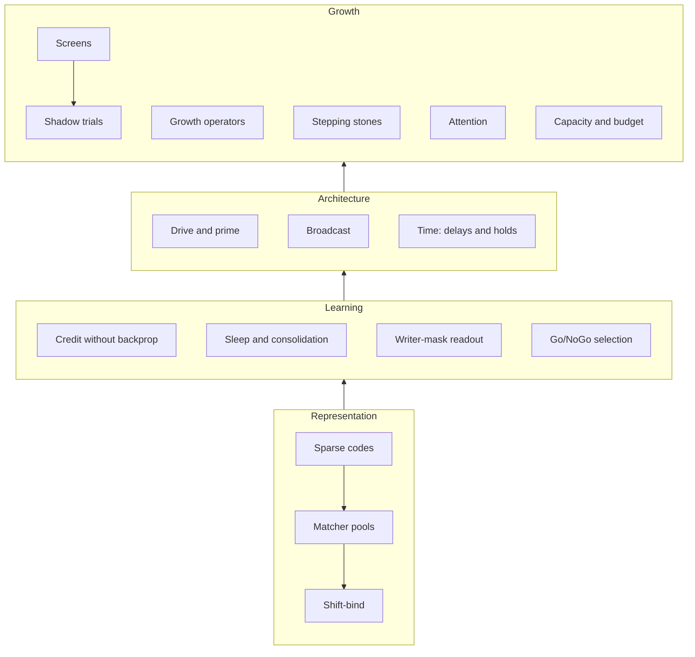

# Concepts

Each concept page explains one idea:
- what it is and how it works;
- the evidence for it, with links to the [experiments](../experiments/README.md) and their numbers;
- the parameters that matter;
- related concepts;
- where it lives in the [reference code](../reference-code.md).

Pages are grouped by layer. Lower layers don't depend on higher ones.

## Representation

- [Sparse codes](sparse-codes.md): every node outputs 32 of 2048 bits, which is what makes any wiring legal.
- [Matcher pools](matcher-pools.md): k-WTA cells that recruit on novelty, evict, and swap bits.
- [Shift-bind](shift-bind.md): how two codes become one pair code without leaking either part.

## Learning

- [Credit without backprop](credit-without-backprop.md): sticky bits, echo, track records, input gating.
- [Sleep and consolidation](sleep-and-consolidation.md): prune what never consolidated, replay, merge duplicates.
- [Writer-mask readout](writer-mask-readout.md): Prime edges as stochastic binary counters with learned gains.
- [Go/NoGo selection](go-nogo-selection.md): actor-critic from masks; exploration through NoGo; Go depression for reversal.

## Architecture

- [Drive and prime](drive-and-prime.md): input creates winners, context only selects among them.
- [Broadcast](broadcast.md): tonic and phasic, scalar and semantic; surprise alarms and consensus.
- [Time: delays and holds](time-delays-and-holds.md): looking back by a fixed lag, or to the last event.

## Growth

- [Screens](screens.md): cheap estimates of what a candidate would add.
- [Shadow trials](shadow-trials.md): how a candidate earns a vote, and loses it.
- [Growth operators](growth-operators.md): bind, conjoin, distill, delay, hold, granules, cleanup.
- [Stepping stones](stepping-stones.md): why depth is reachable only through easier puzzles.
- [Attention](attention.md): where learning time goes, and when to give up.
- [Capacity and budget](capacity-and-budget.md): finite pools, and how growth adapts to them.

See also: [lessons](../lessons.md) (the rules, by layer) · [glossary](../glossary.md) (terms) · [open questions](../open-questions.md).
