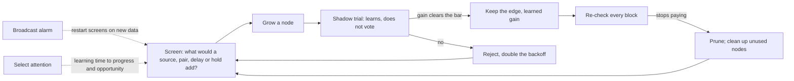

# Growth grammar

The controller grows the network inline, during one lifetime. Nothing is hand-listed: any node can be wired into any target of matching type, and candidates are ranked by how much they would tell the target. A structure is built only on a measured pressure, and its edge votes only after a shadow trial shows a gain. The full current spec is the [growth grammar spec](https://claude.ai/code/artifact/d37e3fa6-5a32-45a9-a6cc-88fcb7fc4d09); this page is the condensed version.

## The loop



## Screens

*Concept page: [screens](concepts/screens.md)*

A candidate source s for target y is scored by the information it adds about y's next state beyond y's current state. The same quantity with s circularly shifted is subtracted, to cancel estimator bias:

```
v(s → y) = I(y[t+1]; s[t] | y[t]) − I(y[t+1]; shifted s[t] | y[t])
```

The shift null under-counts for high-cardinality contexts, especially ones that contain y[t]. For those the word experiment uses a **held-out predictive gain** instead: counts from the first half of the window, Witten-Bell interpolation, and log-loss on the second half.

## Operators

*Concept page: [growth operators](concepts/growth-operators.md)*

| Pressure | Operator | Then |
|---|---|---|
| A source scores above 0.02 bits | Trial a Prime edge | Shadow trial |
| A pair carries information beyond its best part, with enough data per pair | Grow a bind | One-shot priority trial |
| The screen saw ≥ 0.2 bits from a source but its edge failed | Conjoin: bind the source with the target's own state | Priority trial |
| A delayed or event-held value carries information | Grow a delay tap or hold | Priority trial |
| A bind edge is kept with a large gain | Distill the bind | Trial of the distill's edge |
| An unsolved target with screens dry for 3 checks | Grow a granule layer and a readout | Long trial: two passing windows in a row |
| A node nobody uses, already tried, older than 15k ticks | Garbage-collect it | Never a part of a live node, never untried |

## Shadow trials

*Concept page: [shadow trials](concepts/shadow-trials.md)*

1. The trial edge learns from the moment it is built but does not vote.
2. After a burn-in, each tick records the paired difference: loss without the edge minus loss with it. (Toy worlds count top-1 flips; text uses log-loss in bits.)
3. Keep if the mean gain clears the bar and z ≥ 2.5; otherwise reject and double the backoff.
4. Kept edges are re-checked by ablation every block and pruned below a lower bar or when z < 1. The gap between the two bars is hysteresis.
5. At most 2 trials per target and 6 per area. Priority is spent on one trial, never held.
6. Action edges use interleaved trials (alternate ticks with and without), because the reward of an action not taken is never seen.

## Readout

*Concept page: [writer mask readout](concepts/writer-mask-readout.md)*

Each source cell of an edge owns a stack of L writer masks over the target's code space. The target's next cell is a log-linear mix:

```
p(j) ∝ exp( Σ_e β_e · s_e(j) ),   s_e(j) = (1 / 32L) · Σ_k |M[e,k][c_e] ∧ code_j|
```

Level k is written with probability 2^−k, up to 8 bits per write, with the mask size kept constant. Each β is learned by gradient on log-loss. A per-(source cell, target cell) count is updated incrementally through an owner table.

## Attention and surprise

*Concept page: [attention](concepts/attention.md)*

- **Select across inputs:** score = significant progress + 0.02 × structures grown in the last 4 visits + 0.05 × screen opportunity + a small exploration bonus. Never raw surprise: that sends the budget to noise.
- **Broadcast alarm:** fires when the fast accuracy average falls 0.12 below the slow one. It re-checks kept edges early, clears backoffs, drops stale trials, restarts the screens on post-alarm data, and boosts plasticity for 4k ticks. Restarting the screens is the part that matters.
- **Give-up:** dormancy after 6 quiet visits (10 → 80 blocks). A pending brute-force fallback counts as alive.

## Defaults

See the defaults table in the [spec](https://claude.ai/code/artifact/d37e3fa6-5a32-45a9-a6cc-88fcb7fc4d09). Text runs:

| Setting | Value |
|---|---|
| Window | 30k ticks |
| Edge screen | > 0.02 bits |
| Bind screen | > 0.08 bits over the best part, at most W/4 distinct pairs and at most 2 × capacity |
| Trials | Burn-in 4k, evaluate 8k; keep at ≥ 0.01 bits; prune below 0.003 bits per 10k block |
| Bind pools | Capacity 1024 |
| Input pool | Recruit below 10 of 24 bits, merge duplicates under noise |

## How the grammar was validated

[06](experiments/06-growth-interfaces.md) shadow trials and hysteresis · [07](experiments/07-graph-growth.md) generative candidates, binds, parallel trials · [08](experiments/08-bootstrapping.md) distill and depth · [09](experiments/09-attention-temporal.md) temporal moves and attention · [10](experiments/10-full-primitives.md) Correct, Select, Broadcast · [11](experiments/11-real-text.md) real text.
